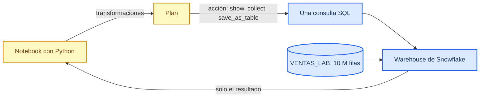
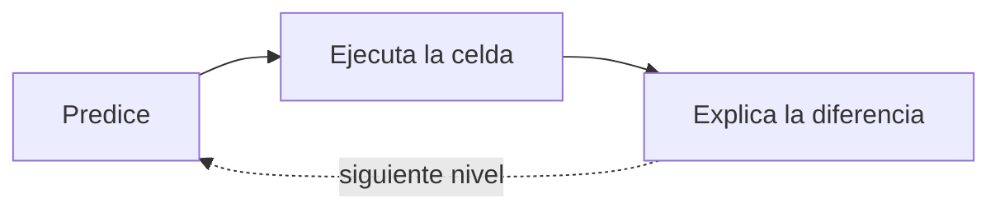

# Snowpark Lab

_Tiempo: unos 50 minutos · Nivel: intermedio (Python y SQL) · Se corre completo dentro de Snowsight_

Este laboratorio sirve para entender dónde corre cada línea de un programa de Snowpark. Vas a crear una tabla de 10 millones de ventas, transformarla con DataFrames y medir lo que pasa: cuántas consultas se ejecutan, cuántos datos viajan a tu notebook y cuánto cuesta meter Python dentro del warehouse.

Cada nivel se trabaja igual. Antes de correr la celda escribes qué crees que va a pasar, luego la corres y comparas. Si tu predicción falla, ahí está lo que vale la pena entender.

## Lo que necesitas saber antes de empezar

Snowpark es una librería de Snowflake para escribir transformaciones con DataFrames en Python, Java o Scala[^docs]. Se parece a pandas o a PySpark, pero el cálculo no ocurre en tu máquina. Cuando escribes `df.filter(...).group_by(...).agg(...)`, Snowpark no toca ninguna fila: arma un plan. Al pedir un resultado con una acción como `show()`, `collect()` o `save_as_table()`, traduce el plan completo a una consulta SQL y la ejecuta en un warehouse[^aimpoint]. Si comentas la acción, no se ejecuta nada; se puede comprobar en el historial de consultas[^des].

La consecuencia práctica es que `collect()` y `to_pandas()` sí traen filas a tu memoria. Si las usas antes de agregar, pierdes lo que Snowpark te da. El nivel 3 lo mide.

Snowpark también permite registrar funciones de Python que corren dentro del warehouse (UDFs), por fila o en lotes de pandas, y empaquetar un pipeline completo como stored procedure[^docs]. Para equipos con código existente hay dos atajos: pandas on Snowflake, que ejecuta la sintaxis de pandas como SQL, y Snowpark Connect, que corre código de PySpark en Snowflake. Snowpark Connect pasa más del 85% de las pruebas de DataFrame de PySpark, pero no soporta RDD, MLlib ni `repartition`[^connect].

## Requisitos

| Necesitas | Detalle |
| --- | --- |
| Acceso a Snowsight | Con un rol que pueda crear tablas en algún schema |
| Un warehouse | X-Small alcanza; el lab gasta unos minutos de cómputo |
| Nada que instalar | El notebook usa la sesión de Snowsight con `get_active_session()`, sin llaves ni contraseñas |

## Cómo empezar

1. Descarga [`LAB_SNOWPARK_ALUMNOS.ipynb`](LAB_SNOWPARK_ALUMNOS.ipynb).
2. En Snowsight ve a **Projects → Workspaces → Add new → Upload** y sube el archivo.
3. Abre el notebook y elige tu warehouse.
4. En la primera celda de código, cambia `MI_BASE.MI_SCHEMA` por la base y el schema donde puedes crear tablas.
5. Corre las celdas en orden. La que crea `VENTAS_LAB` tarda alrededor de un minuto.

## Los niveles

| Nivel | Qué haces | Qué deberías entender al final |
| --- | --- | --- |
| 1 · El plan | Lees el SQL que Snowpark generó con `queries` y `explain()` | Que definir un DataFrame no ejecuta nada |
| 2 · Ejecución diferida | Cuentas consultas con `query_history()` antes y después de una acción | Que cada acción vuelve a ejecutar el plan, y para qué sirve `cache_result()` |
| 3 · Pushdown | Sumas por región en Snowflake y con `to_pandas()`, y comparas tiempo y memoria | Por qué se agrega antes de traer datos |
| 4 · UDFs | Clasificas un millón de ventas con una función nativa, una UDF y una UDF vectorizada | En qué orden conviene elegirlas |
| 5 · Pipeline | Corres el mismo pipeline con `overwrite` y con `append`, y lo empaquetas como procedure | Qué hace que un job se pueda reintentar sin duplicar |
| Desafío | Traduces un job de PySpark a Snowpark | Las equivalencias de la API |

Los niveles 4 y 5 crean una UDF y un stored procedure temporales. Si tu rol no tiene permiso, la celda muestra el mensaje de Snowflake y puedes seguir con el siguiente nivel.

## Antes de irte

Corre la última celda del notebook. Borra `VENTAS_LAB`, `RESUMEN_MENSUAL_LAB` y `TOP_SKU_LAB`, para no dejar 10 millones de filas de prueba en el schema.

## Problemas comunes

| Lo que ves | Causa más probable |
| --- | --- |
| `Insufficient privileges` al crear `VENTAS_LAB` | Tu rol no puede crear tablas en ese schema. Cámbialo en la primera celda por uno donde sí puedas |
| `get_active_session` no existe | Abriste un worksheet SQL en lugar de un notebook de Python |
| El bonus de pandas dice que falta `modin` | Agrega el paquete `modin` en **Packages** del notebook y vuelve a correr la celda |
| La celda de la UDF muestra un error de permisos | Tu rol no puede crear funciones. El resto del lab funciona igual |

## Referencias

[^docs]: Snowflake. "Snowpark Developer Guide for Python." https://docs.snowflake.com/en/developer-guide/snowpark/python/index
[^aimpoint]: Aimpoint Digital. "Snowpark for Python, Snowflake Tutorial." YouTube, 2023. https://www.youtube.com/watch?v=udcFnIvXFnE
[^des]: Data Engineering Simplified. "What is Snowpark in Snowflake." YouTube, 2023. https://www.youtube.com/watch?v=-awSPRW9AOY
[^connect]: Snowflake Developers. "How To Run Existing Spark Code Directly On Snowflake With Snowpark Connect." YouTube, 2025. https://www.youtube.com/watch?v=aENolfHIvLI
